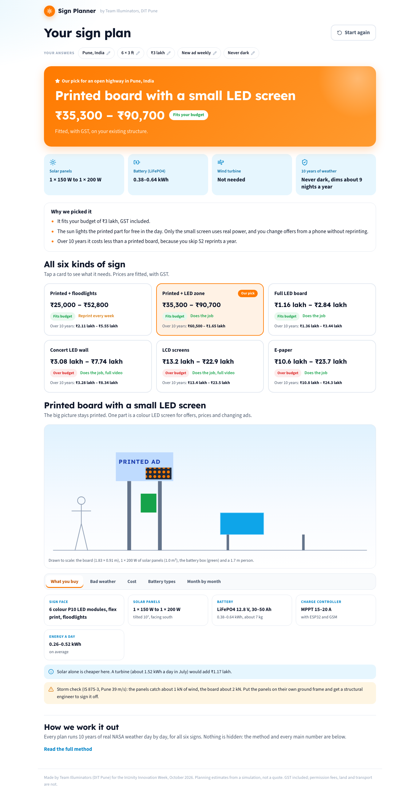

# Off-Grid Sign Planner

A web app for planning an off-grid solar sign. You enter the board size, budget and place. The app suggests the sign type (printed, printed + LED zone, full LED, concert LED wall, LCD or e-paper), the solar panels, the battery and, if it pays, a wind turbine.

We made it as Team Illuminators (DIT Pune) for the InUnity Entrepreneurial Mindset Program in October 2026, and it was selected for the proof-of-concept round. The web app was built with Claude Code.



## How it works

For each option, the app runs the battery day by day through 10 years of NASA POWER daily weather (2015–2024) and counts the nights the sign would dim or go dark. The weather data covers 9 places, and you can also fetch another place from NASA.

## What to keep in mind

- It is a simulation. The results have not been compared with a real sign or a test rig yet.
- Prices are rough ranges for planning, not supplier quotes.
- We checked the model by running sample cases and reading the output. There are no automatic pass/fail tests yet.

## Run it

```bash
npm install        # first time only
npm run dev        # then open http://localhost:3000
```

For the fast version: `npm run build`, then `npm run start`.

## Where things are

| Path | What it does |
|---|---|
| `src/components/Planner.tsx` | The app: welcome, progress bar, steps, then the results page |
| `src/components/Wizard.tsx` | The 5 steps (place, size, budget, use, reliability) with big tap cards; "another place on Earth" via NASA |
| `src/components/Results.tsx` | Orange "our pick" banner, blue fact tiles, why we picked it, the six option cards |
| `src/components/OptionDetail.tsx` | "How it looks" (day/night, sample ads), then tabs: what you buy (with the to-scale drawing), bad weather, cost, battery types, month by month |
| `src/components/PowerStory.tsx` | How solar and wind power it: animated power flow, place-specific explanations, and an hour-by-hour average day (sunniest vs darkest month) |
| `src/components/SignPreview.tsx` | Picture of the board with a sample ad (dhaba, phone shop, road safety), by day and at night |
| `src/components/BatteryChart.tsx` | Battery level after each night for a chosen year |
| `src/components/Method.tsx` | How we work it out, and the main numbers |
| `src/lib/plan.worker.ts` | Runs the simulation in the background so the page never freezes |
| `src/lib/model.ts`, `planner.ts`, `parts.ts` | The physics, prices and parts |
| `public/data/world_daily.json` | NASA POWER daily data 2015–2024 for 9 places |
| `docs/` | Screenshots |

Comments in `src/lib` mention a `Sign_Planner/model` folder. That is where we first wrote the model, and it is not in this repo.

## Look

Step-by-step wizard, white page, bright sun-orange (#FF7A00) for choices, buttons and our pick, sky-blue (#0EA5E9) for solar and battery facts, green / amber / red only for budget status. Headings in Lexend, text in Source Sans 3.

## v5 (9 Oct 2026)

- Wizard step 2 asks how close people stand: this picks the LED dot size (P4–P10). Results show pixels and "sharp from / smooth from".
- More options: LED module type (energy-saving or standard), and power: sun, sun + wind, sun + stream turbine, sun on the board + generator, generator only (diesel or biodiesel).
- Detail view: new "Power choices" tab (the same sign with every power choice: battery, panels, land, fuel a year, price, 10-year cost). It is worked out only when the tab opens.
- Power story and charts show a stream or generator; the drawing shows the generator box; costs list the media player, generator and stream turbine.
- Space (9 Oct): step 1 asks if there is free ground for panels (default no: panels only on the sign's own frame) and if the back of the board faces the sun (upright back panels, about 60% yield). Options that need more panels show "Needs land for panels".
